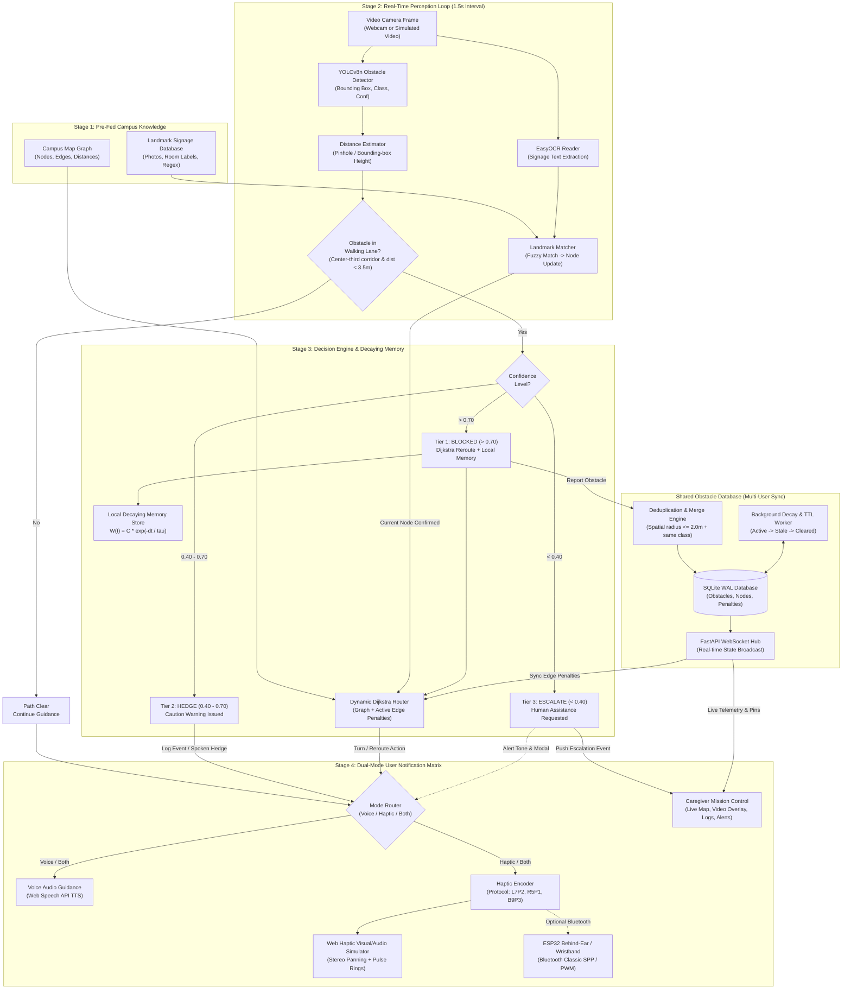
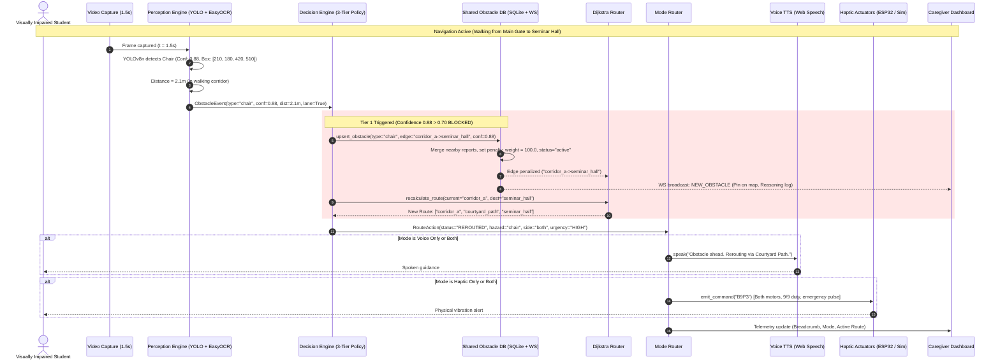

# CampusEcho System Architecture & Data Flow

This document details the complete end-to-end architecture of **CampusEcho**, integrating the 4-stage pipeline, the 3-tier confidence policy, the dynamic decaying memory model, and the real-time shared obstacle database.

---

## 1. End-to-End System Architecture Diagram



---

## 2. Event-Driven Reaction Flow (Sequence Diagram)



---

## 3. Shared Obstacle Database Specifications

### 3.1 SQLite Schema (`obstacles`)
```sql
CREATE TABLE IF NOT EXISTS obstacles (
    id TEXT PRIMARY KEY,               -- e.g. "obs_corr_a_chair_001"
    obstacle_type TEXT NOT NULL,       -- "chair", "trash_can", "person", "wet_floor", "closed_door"
    edge_id TEXT NOT NULL,             -- e.g. "corridor_a_to_seminar_hall"
    offset_m REAL NOT NULL,            -- distance along edge in meters (e.g. 12.5)
    confidence REAL NOT NULL,          -- current decayed confidence [0.0 - 1.0]
    initial_confidence REAL NOT NULL,  -- original detection confidence
    distance_m REAL NOT NULL,          -- estimated distance when reported
    first_seen TIMESTAMP NOT NULL,     -- first detected timestamp
    last_seen TIMESTAMP NOT NULL,      -- most recent confirmation timestamp
    times_confirmed INTEGER DEFAULT 1, -- confirmation count across sessions
    reporter_id TEXT NOT NULL,         -- session/user ID
    status TEXT NOT NULL,              -- "active", "stale", "cleared"
    ttl_seconds INTEGER DEFAULT 300    -- time-to-live before expiration
);
```

### 3.2 Decay & Penalty Mathematical Model
1. **Confidence Decay Formula:**
   $$\text{confidence}(t) = \text{initial\_confidence} \times e^{-\frac{t - t_{\text{last\_seen}}}{\tau}}$$
   *Where $\tau = \frac{\text{half\_life}}{\ln(2)}$ (half-life configured to 180 seconds for demo).*
2. **Dijkstra Dynamic Edge Weight:**
   $$\text{EffectiveWeight}(e) = \text{BaseDistance}(e) + \sum_{o \in \text{obstacles}(e)} \left( \text{PenaltyMultiplier} \times \text{confidence}_o(t) \right)$$
   *If $\text{status} = \text{"active"}$, $\text{PenaltyMultiplier} = 150.0$ (effectively blocks the path unless no alternative exists).*
   *If $\text{status} = \text{"stale"}$ ($0.30 \le \text{confidence} < 0.60$), $\text{PenaltyMultiplier} = 30.0$ (path allowed if necessary, triggering a HEDGE warning).*
   *If $\text{confidence} < 0.30$, status is marked `"cleared"` and penalty drops to 0.*

### 3.3 Spatial Deduplication & Confirmation Rule
- When a new detection is reported on edge $e$ with obstacle type $T$ at offset $x$:
  - Query existing active/stale obstacles on edge $e$ matching type $T$.
  - If $|x_{\text{existing}} - x_{\text{new}}| \le 2.0\text{ meters}$:
    - **Merge & Refresh:** Update $t_{\text{last\_seen}} = \text{now}$, increment $\text{times\_confirmed} += 1$, set $\text{confidence} = \min(1.0, \text{confidence} + 0.15)$, set $\text{status} = \text{"active"}$.
  - If no match within 2.0m:
    - **Insert** new obstacle record.

---

## 4. Component Event-Response Matrix

| Triggering Event | Processing Component | Action Taken | Output Generated |
|---|---|---|---|
| **Webcam frame received (every 1.5s)** | YOLOv8n + Distance Estimator | Detects objects, computes bounding-box center and relative distance. | Array of `DetectedObstacle` objects. |
| **Obstacle detected in walking corridor with Conf > 0.70** | Decision Engine (Tier 1) | Upserts hazard into Shared DB, marks edge penalty, triggers Dijkstra replan. | Voice: *"Obstacle ahead. Rerouting."*<br/>Haptic: `B9P3`<br/>Dashboard: Red hazard pin + route update. |
| **Obstacle detected with Conf 0.40 – 0.70** | Decision Engine (Tier 2) | Logs hazard as unconfirmed, does NOT reroute. | Voice: *"Caution, possible obstacle ahead."*<br/>Haptic: Single warning pulse (`B5P1`). |
| **Ambiguous feature detected with Conf < 0.40 in hazard zone** | Decision Engine (Tier 3) | Freezes guidance, alerts bystanders, pushes escalation ticket to dashboard. | Voice: *"Uncertain path ahead. Requesting assistance."*<br/>Dashboard: Escalation Modal with camera frame snapshot. |
| **Signage text detected by EasyOCR** | Landmark Matcher | Fuzzy matches recognized text against known campus graph labels. | Position update: *"Arrived at Corridor A."*<br/>Recalibrates current graph node. |
| **User passes location without re-detecting obstacle** | Perception + Decision Engine | Emits `CLEAR_CONFIRMATION` event to Shared DB. | DB reduces confidence by 0.25; if $< 0.30$, marks `cleared`. |
| **Mode Toggle changed (Voice $\rightarrow$ Haptic $\rightarrow$ Both)** | Mode Router | Adjusts active channel routing without restarting navigation. | Confirmation tone/pulse; routes guidance to selected outputs. |
